<p align="center">
  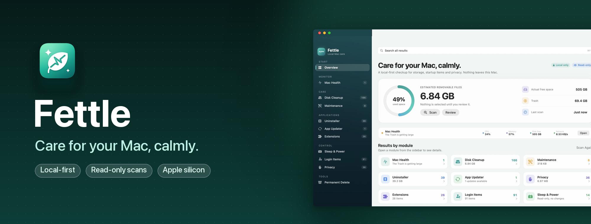
</p>

<p align="center">
  <b>Care for your Mac, calmly.</b><br>
  A native macOS care utility: disk cleanup, maintenance, uninstaller, app updates,<br>
  privacy cleanup and live Mac Health in one app.
</p>

<p align="center">
  <a href="https://github.com/Stijnus/fettle/releases/latest">
    
  </a>
  <a href="#build-from-source">
    
  </a>
</p>

<p align="center">
  
  
  
  
  
</p>

<p align="center">
  <sub>Scans stay on the Mac. No account, no administrator password, nothing uploaded.<br>
  The only network requests are update checks: Fettle's own signed feed and, when you run App Updater, each app's own feed.</sub>
</p>

---

## Contents

[Screens](#screens) · [What's inside](#whats-inside) · [Disk Cleanup](#disk-cleanup) ·
[Mac Health](#mac-health) · [App Updater](#app-updater) · [Settings](#settings) · [Safety model](#safety-model) ·
[Install](#install) · [Build from source](#build-from-source) · [Tests](#tests) ·
[Limitations](#limitations) · [Development](#development) · [Project layout](#project-layout) ·
[License](#license)

## Screens

Fettle is one window with a sidebar: an overview, ten care tools and a menu bar
popover. Every screen is a real capture of the built app in light appearance — the
Login Items and Maintenance lists use a sample account so no personal paths appear.
A complete dark appearance and English/Dutch interface strings ship too.

<a href="docs/screenshots/overview.webp">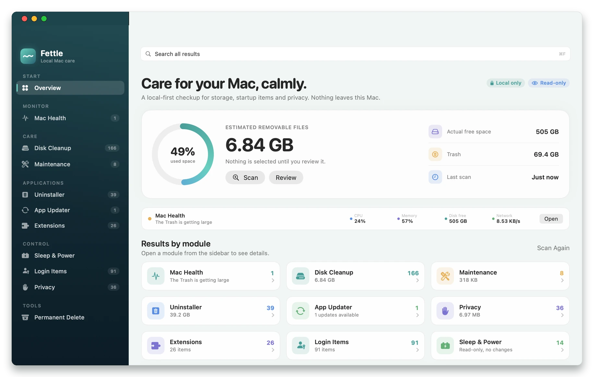</a>

| Disk Cleanup | Mac Health |
| :---: | :---: |
| <a href="docs/screenshots/disk-cleanup.webp">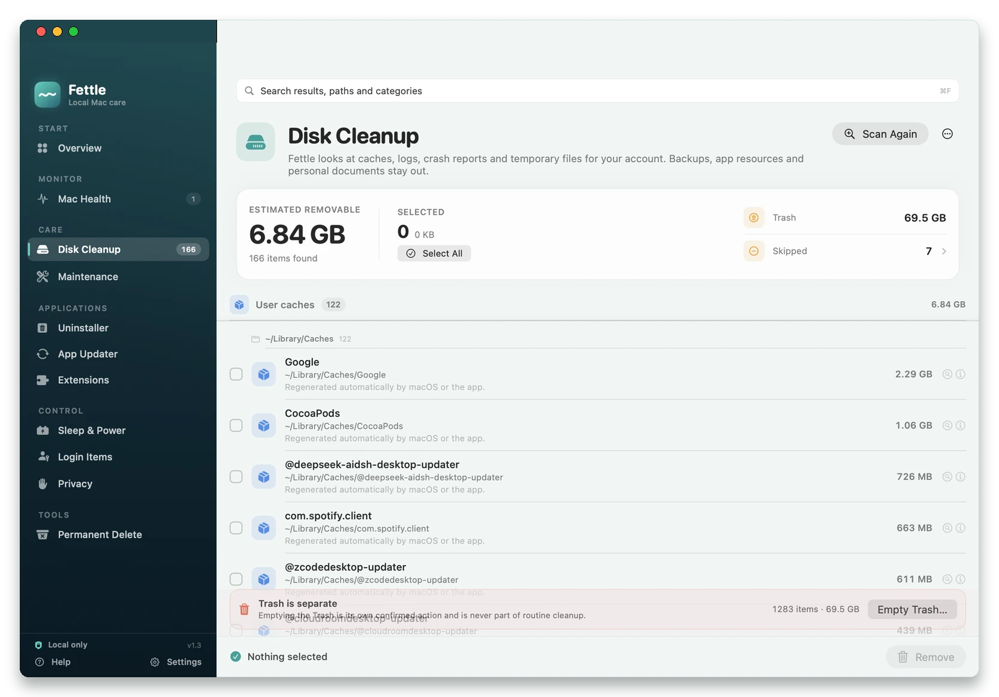</a> | <a href="docs/screenshots/mac-health.webp">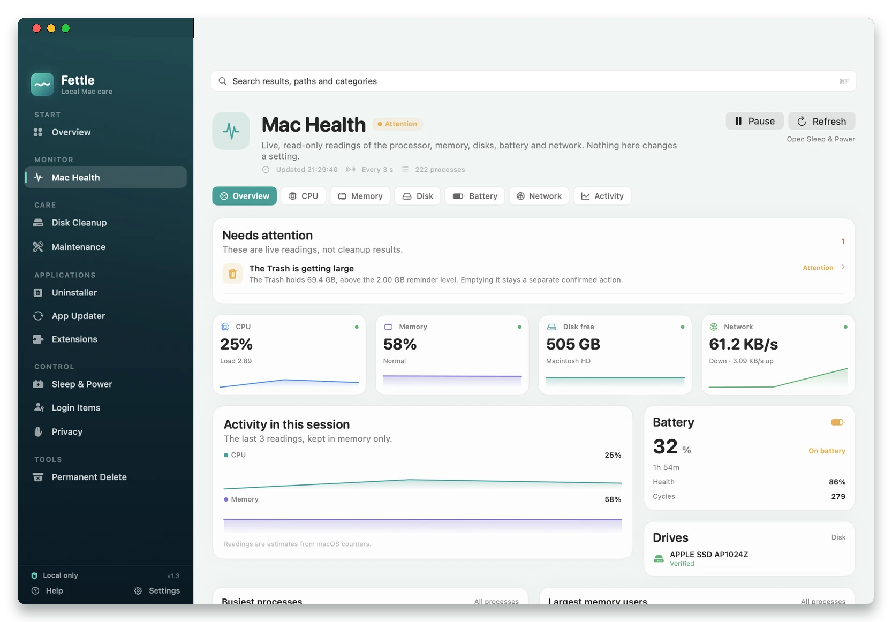</a> |
| <sub>User caches, logs, crash reports and Trash — grouped, sized, reviewable.</sub> | <sub>Live readings that never change a setting.</sub> |

| Uninstaller | App Updater |
| :---: | :---: |
| <a href="docs/screenshots/uninstaller.webp">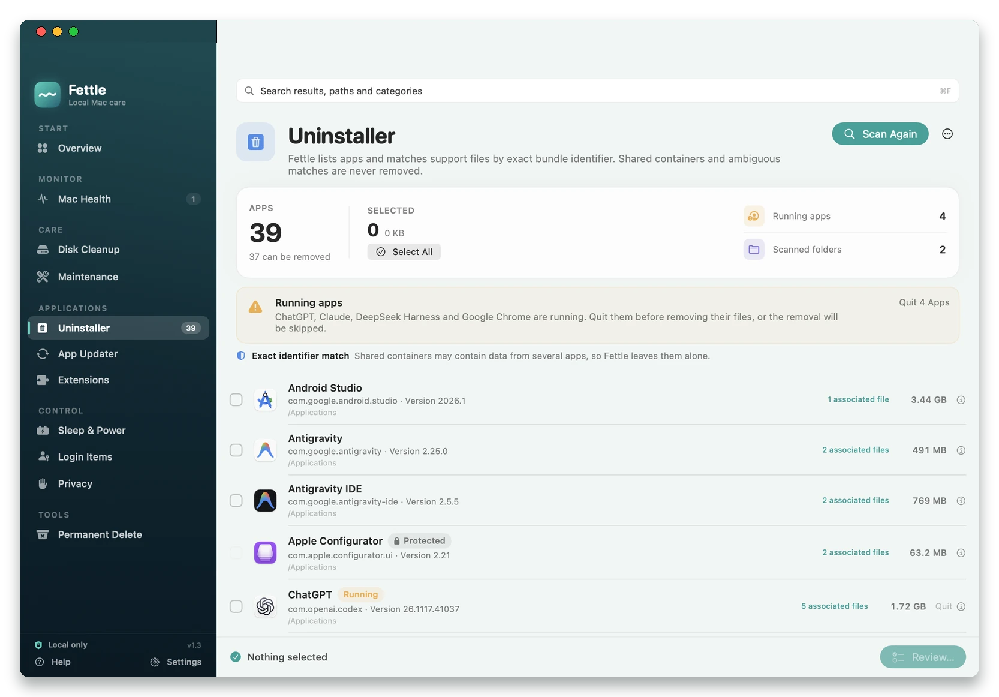</a> | <a href="docs/screenshots/app-updater.webp">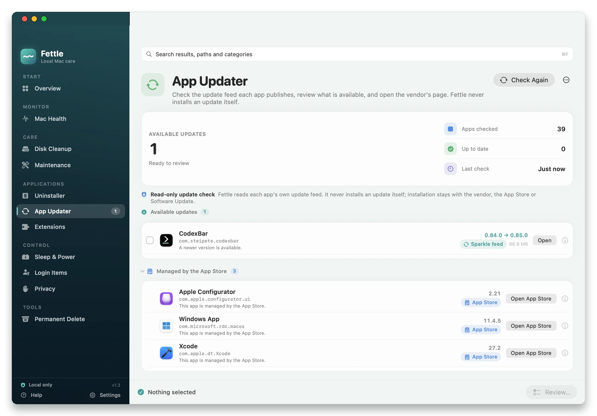</a> |
| <sub>Apps and their files, matched by exact bundle identifier only.</sub> | <sub>Each app's own update feed — Fettle never runs an installer.</sub> |

| Privacy | Maintenance |
| :---: | :---: |
| <a href="docs/screenshots/privacy.webp">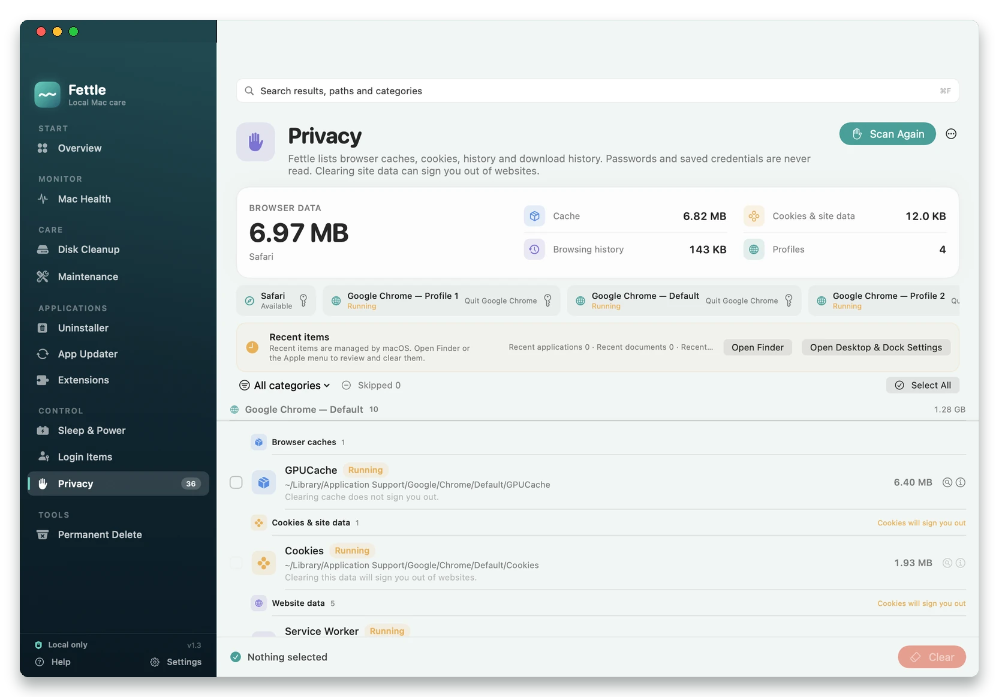</a> | <a href="docs/screenshots/maintenance.webp">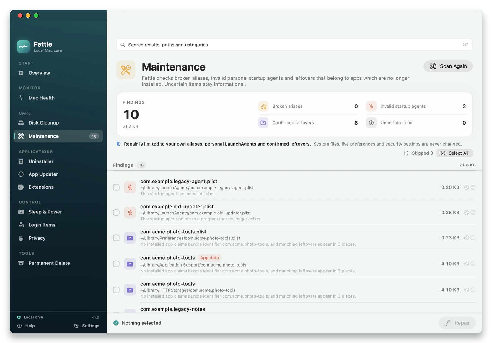</a> |
| <sub>Browser data by profile. Passwords are never read.</sub> | <sub>Every finding carries evidence; uncertain items stay informational.</sub> |

| Extensions | Login Items |
| :---: | :---: |
| <a href="docs/screenshots/extensions.webp">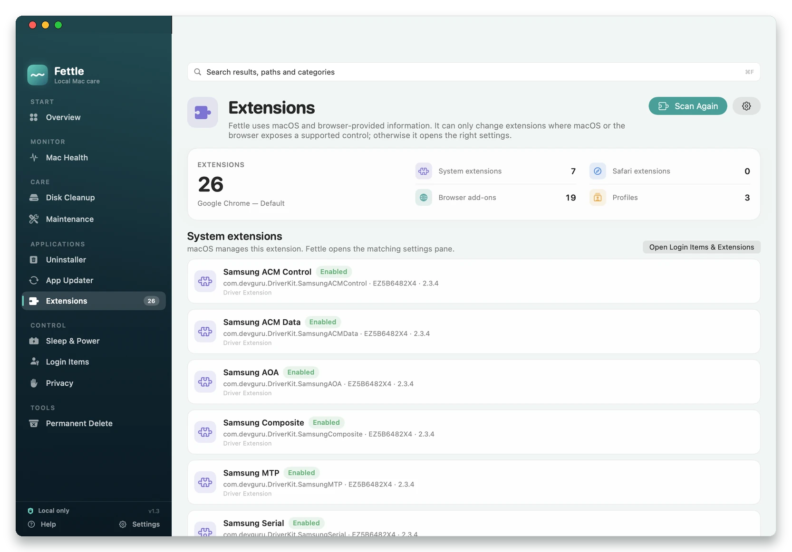</a> | <a href="docs/screenshots/login-items.webp">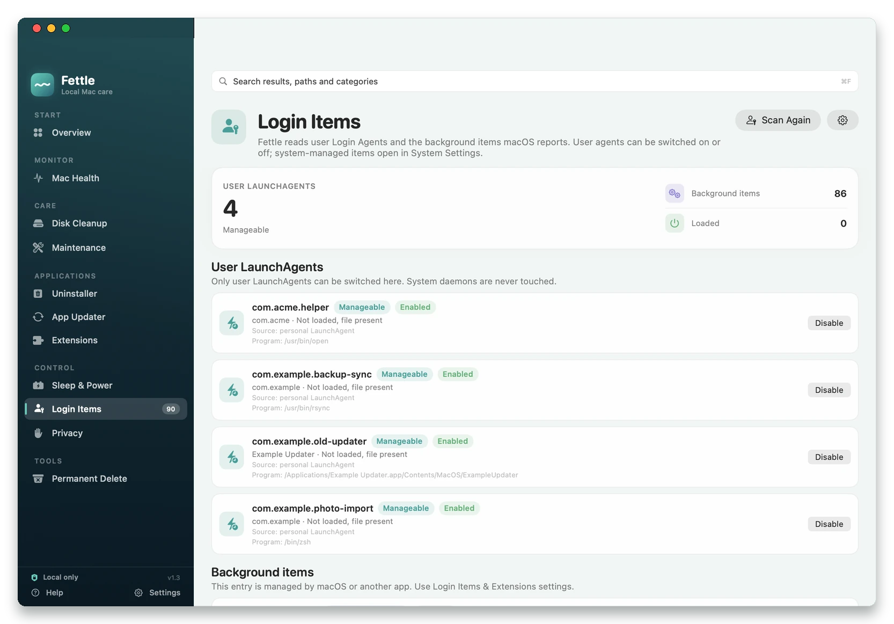</a> |
| <sub>System extensions, Safari extensions and browser add-ons.</sub> | <sub>User LaunchAgents are reversible; system daemons are never touched.</sub> |

| Sleep & Power | Permanent Delete |
| :---: | :---: |
| <a href="docs/screenshots/sleep-power.webp">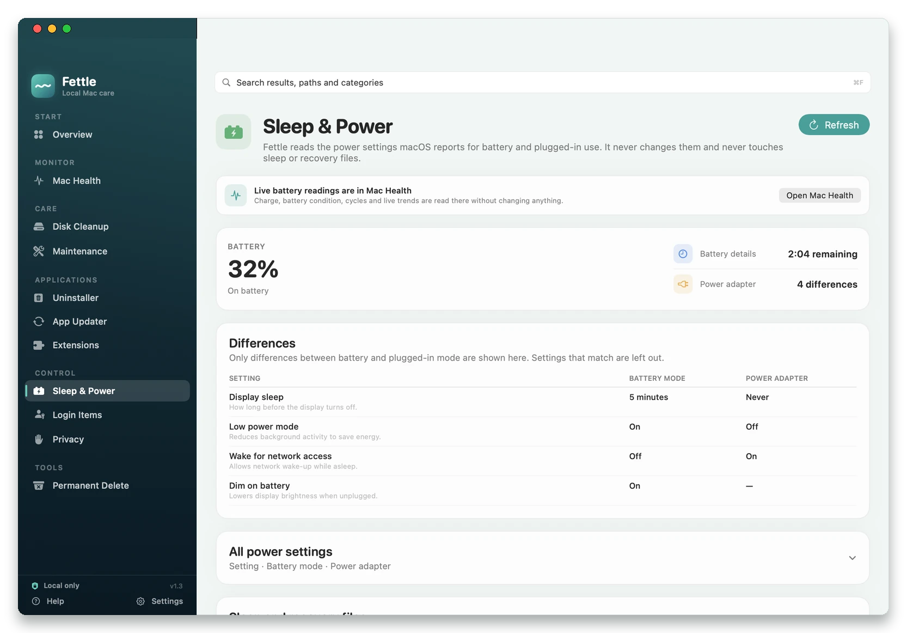</a> | <a href="docs/screenshots/permanent-delete.webp">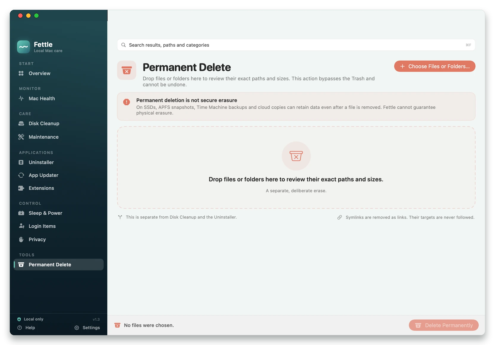</a> |
| <sub>A read-only <code>pmset</code> view with routes into System Settings.</sub> | <sub>Separate from the Trash, with a typed confirmation and honest warnings.</sub> |

| Settings | Menu bar |
| :---: | :---: |
| <a href="docs/screenshots/settings.webp">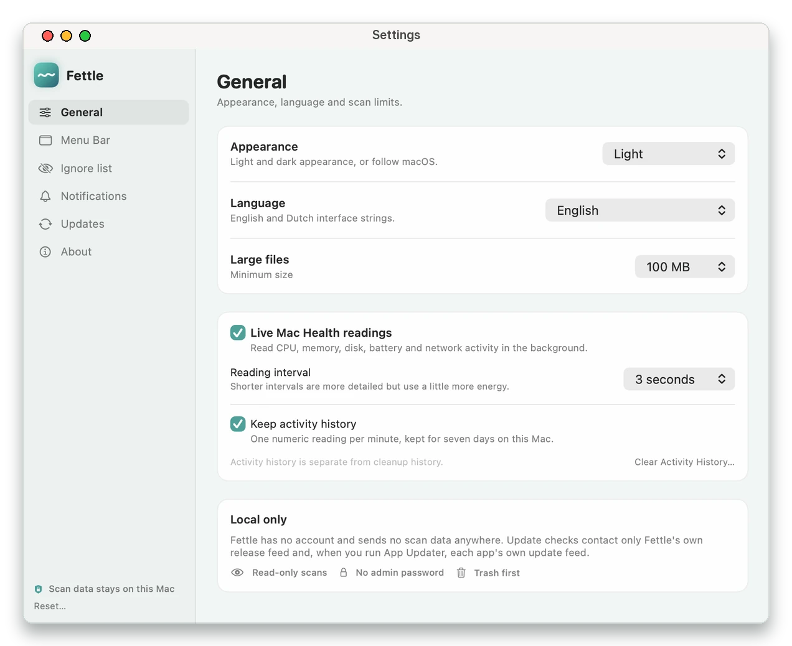</a> | <a href="docs/screenshots/menu-bar.webp">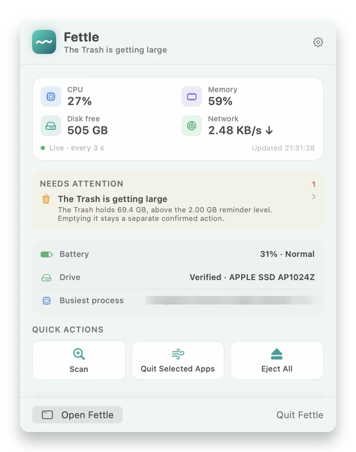</a> |
| <sub>Appearance, language, monitoring, alerts, ignore list and updates.</sub> | <sub>Live readings, Scan, Quit Selected Apps and Eject All — one click away.</sub> |

## What's inside

The name is the promise: *in fine fettle* means in good health and good condition.

| Module | What it does |
| --- | --- |
| **Overview** | Disk usage, the live Mac Health strip, last scan and results by module. One read-only **Scan** action, and a clear separation between estimated removable bytes, bytes moved to the Trash and macOS's reported free space. When a scan could not read something, Overview says so and the module shows the skipped path and reason. |
| **Disk Cleanup** | User caches, old logs, crash reports, temporary files and the current user's Trash, grouped by category and location. A separate large-file view scans folders you choose. Trash is emptied only through its own confirmed action. |
| **Maintenance** | Broken user-owned aliases, invalid personal LaunchAgents, broken preference lists and confirmed leftovers from removed apps. Every finding carries evidence; uncertain items stay informational. |
| **Uninstaller** | Apps from `/Applications`, `~/Applications` and folders you add. Associated files are matched by exact bundle identifier only, including the `SDMHelpData` and Adobe AIR `ELS` leftover roots. Shared containers are excluded. A separate leftover scan covers apps that were already removed. |
| **App Updater** | Reads the update feed each app publishes (Sparkle appcast) and recognises App Store and Apple apps. Shows current and latest versions, source, release date, update size and release notes, with a **Review** sheet to choose which updates to open. Fettle never downloads or runs an installer. |
| **Mac Health** | Live CPU, memory, disk, battery and network pages, plus a persisted Activity page. Trend lines, per-core load, top process lists, quit/force-quit with confirmation, SMART drive data, Eject All and six alert kinds. |
| **Extensions** | System extensions reported by `systemextensionsctl`, Safari extensions where discoverable, and Chrome, Edge, Opera and Firefox add-ons read from their profiles. Management opens the supported settings surface. |
| **Login Items** | User LaunchAgents with reversible enable/disable through `launchctl`, plus the macOS background items `sfltool` can report. System daemons are never modified. |
| **Privacy** | Browser cache, cookies/site data, browsing history and download history by browser and profile, with sign-out explanations. Download files are preserved and passwords are never read. |
| **Sleep & Power** | A read-only `pmset` view of battery and power-adapter settings, differences, sleep/recovery files, a link to the live Battery page and routes into System Settings. |
| **Permanent Delete** | A separate drag-and-drop screen: exact paths and sizes, a typed confirmation, per-item results, and a clear warning about SSD wear levelling, APFS snapshots, backups and cloud copies. |
| **Menu bar** | A popover with live readings, Scan, Quit Selected Apps, Eject All, settings and an at-a-glance battery/drive/busiest-process summary. Background mode keeps Fettle available after the window closes. |

## Disk Cleanup

Fettle looks at what an ordinary care utility can safely clean for *your* account —
caches, logs, crash reports, temporary files — and keeps backups, signed app
resources and personal documents out of routine cleanup. Results are grouped by
category and location, with sizes and paths, and each group explains what happens
when it is removed.

- Selections start empty; **Select All** is always followed by a review.
- Skipped files are listed with the path and the reason, never silently dropped.
- The Trash is a separate category with its own confirmed **Empty Trash** action.
- A large-file view scans only the folders you pick, with a minimum size you choose.

## Mac Health

Mac Health is read-only: it reads macOS counters and never changes a setting. CPU
and memory have trend lines and per-core load; disk lists volumes and drive
health; battery shows charge, health, cycles, condition, temperature and adapter;
network shows counters, addresses and live rates.

<a href="docs/screenshots/cpu.webp">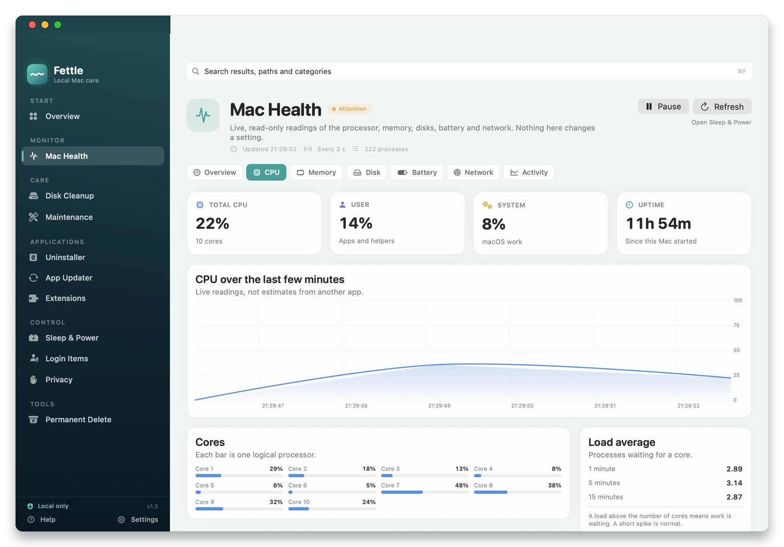</a> <a href="docs/screenshots/memory.webp">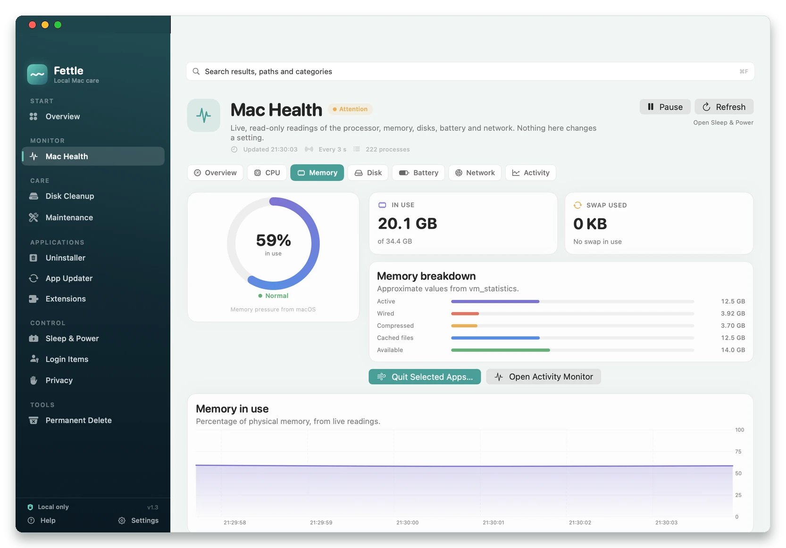</a> <a href="docs/screenshots/disk-health.webp">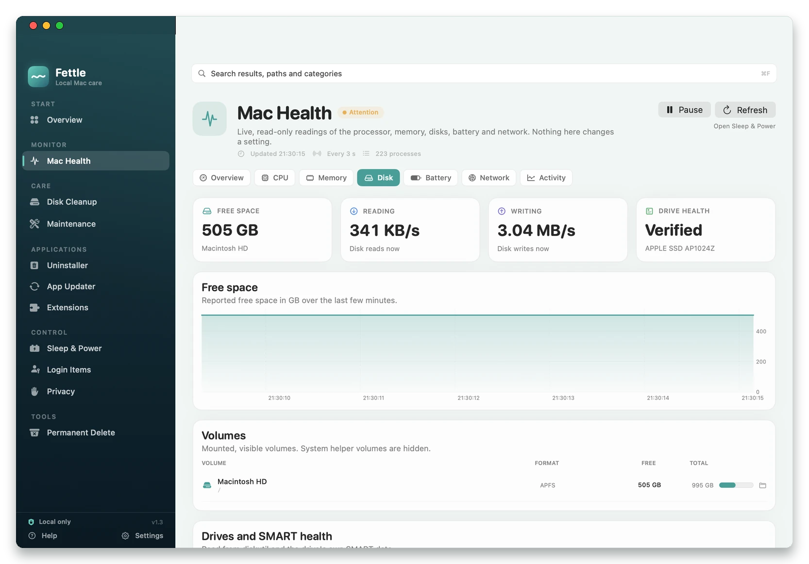</a>

<a href="docs/screenshots/battery.webp">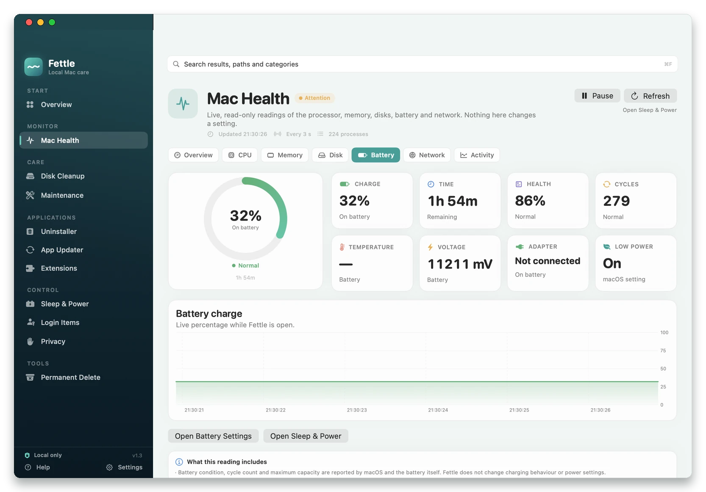</a> <a href="docs/screenshots/network.webp">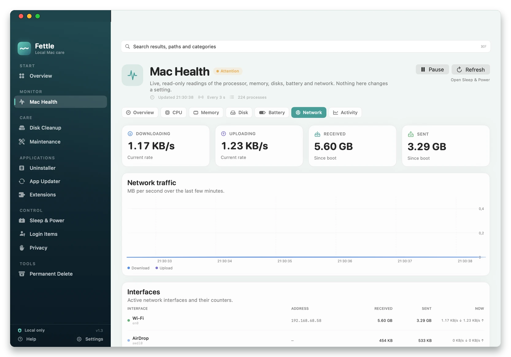</a> <a href="docs/screenshots/activity.webp">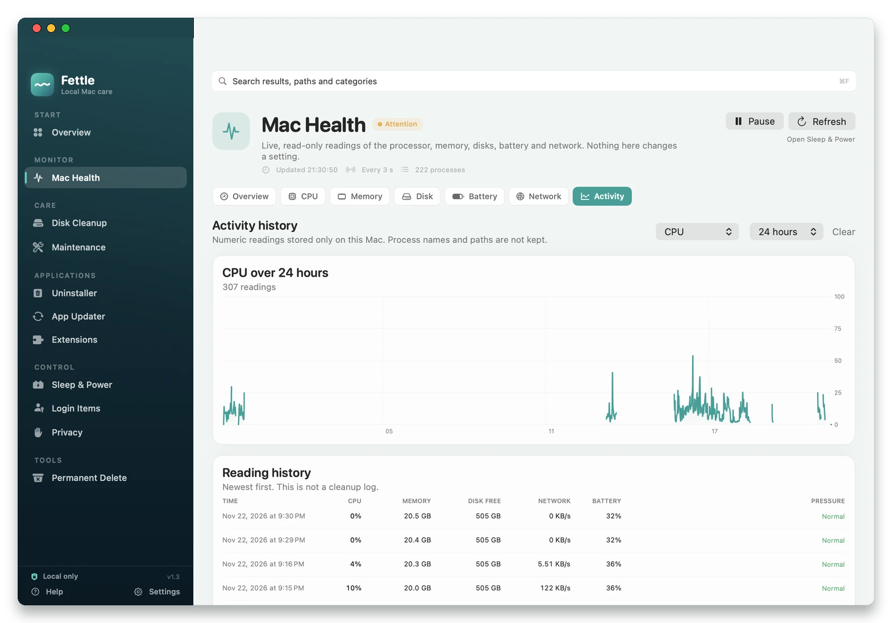</a>

- Six alert kinds: memory pressure, high CPU, low disk, a large Trash, external
  drives and drive health.
- **Quit Selected Apps** only asks apps to quit and measures the result; it never
  forces a purge or asks for an administrator password.
- Activity history keeps one numeric reading per minute for seven days, shows
  gaps where Fettle was not running, and never stores process names.
- An opt-in Accessibility check reports apps that do not respond and tells a slow
  launch apart from a confirmed timeout.

## App Updater

Fettle checks the update feed each app publishes and shows what is actually
available — current → latest version, source, release date, size and notes. The
final step always belongs to the vendor, the App Store or Software Update.

| Results | Review |
| :---: | :---: |
| <a href="docs/screenshots/app-updater.webp"></a> | <a href="docs/screenshots/app-updater-review.webp">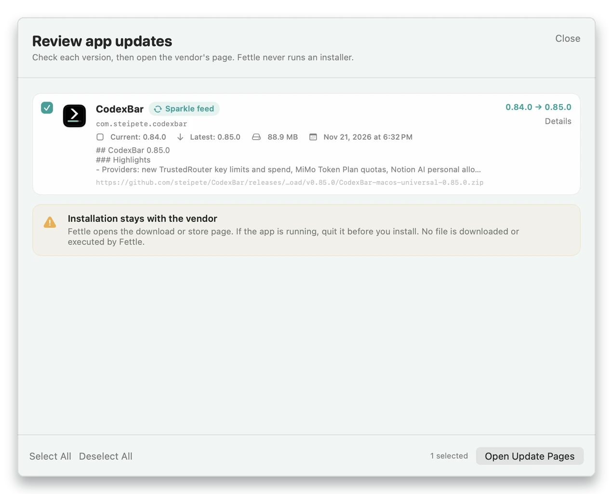</a> |

- Manual by default; automatic checks and inclusion in Scan are opt-in.
- Any scanned app can be ignored.
- Apps without a readable feed get an **Open App** action so their own updater can run.
- After a vendor update, Fettle rereads the installed version.

## Settings

Everything here is local, reversible and off by default when it could get in your way.

- A persistent ignore list, live monitoring on/off with a sample interval, and
  seven-day numeric activity history.
- Menu bar visibility and CPU percentage, background mode, and Open at Login through
  the supported macOS login-item API.
- Opt-in cleanup and Trash reminders at 3/7/14/30-day intervals, with a 2 GB default.
- Six health alerts (memory pressure, high CPU threshold, low disk, large Trash,
  external drives and drive health), notification and sound choices, and an
  external-drive prompt.
- Light/dark appearance, English/Dutch interface, and manual or opt-in update checks
  against an Ed25519-signed release feed.

## Safety model

- Scans only read metadata — names, sizes, dates. Contents are never uploaded.
- Selections start empty. Every change is shown and confirmed first.
- Ordinary cleanup and app removal use the Trash. Emptying the Trash and Permanent
  Delete are separate confirmed actions.
- Each item is rechecked immediately before acting; changed, missing or out-of-scope
  items are skipped and reported.
- Paths are canonicalised with `realpath` and checked against approved roots.
  Symbolic links are not followed.
- No administrator password is requested, no macOS protection is bypassed, and no
  credentials, keychains or password databases are read.
- Mac Health readings are read-only. Process actions show the process name and
  revalidate its identity immediately before quitting; force quit is separate and
  confirmed.
- App Updater uses a cookie-free ephemeral session, contacts only the feed URL an
  app publishes, and never reads credentials.
- The ignore list, history, activity history and settings are stored locally.

## Install

1. Download the latest **`Fettle-<version>.dmg`** from
   [Releases](https://github.com/Stijnus/fettle/releases/latest).
2. Open it and drag **Fettle** into **Applications**.
3. Launch it. The first scan is read-only; nothing is selected until you review it.

The release build is signed ad hoc, not notarised, so Gatekeeper asks once. If macOS
blocks the app, right-click it → **Open**, or run:

```sh
xattr -dr com.apple.quarantine /Applications/Fettle.app
```

Requires macOS 14 Sonoma or later on Apple silicon.

## Build from source

Open `Fettle.xcodeproj` in Xcode, choose the `Fettle` scheme and press Run.

From a terminal:

```sh
make          # builds Release and refreshes build/Fettle.app
make test     # runs the self-test and integration test
```

`make` runs the same `xcodebuild` invocation:

```sh
xcodebuild -project Fettle.xcodeproj -scheme Fettle \
  -configuration Release -derivedDataPath .build-release build

open .build-release/Build/Products/Release/Fettle.app
```

The built app lands in `build/Fettle.app` (ignored by git). Xcode 16 or later is
required; the project is built and tested with Xcode 27.2 on macOS 27.3.

## Tests

The app contains hidden, non-destructive test modes. They create a disposable home
folder under the system temporary directory and never touch the real user's files.

```sh
build/Fettle.app/Contents/MacOS/Fettle --self-test
build/Fettle.app/Contents/MacOS/Fettle --integration-test
```

`--self-test` covers scanners, path safety, change detection, Trash and permanent
delete, symlink handling, download-history preservation, extension parsing,
login-item parsing, power parsing, appcast parsing and version order, updater source
detection, health parsers, alert evaluation, activity-history persistence,
process-safety guards, persistence, localisation, signature verification and
permission reporting. `--integration-test` drives the module models through
scan → select → confirm → act with disposable fixtures, including quitting a
disposable process, Quit Selected Apps, and ejecting a disposable disk image.

`--health-probe` prints a live JSON snapshot of Mac Health without opening a window.
`--ui-preview` renders real window contents to a PNG for development layout review
without Screen Recording permission; the screenshots above are captured with it.
It is not part of the interface.

A JSON copy of the last self-test result is written to the system temporary folder
(`NSTemporaryDirectory()`), or to the path after `--self-test-output`.

## Limitations

See [`FEATURE-MATRIX.md`](FEATURE-MATRIX.md) for the module-by-module matrix and the
exact limits of each macOS interface. The main ones:

- Some macOS data needs Full Disk Access. Fettle never requests it automatically and
  reports what it could not read.
- System-managed extensions and login items open System Settings; they cannot be
  toggled by a third-party app.
- Browser add-ons are managed by their browser. Fettle opens the browser's extension
  page.
- App Updater can only offer an update when the app publishes a readable Sparkle
  feed. App Store and Apple apps are routed to their supported update pages, and apps
  without a feed are reported as such. Fettle never installs an update itself, so a
  vendor installer or store page still has to finish the job.
- macOS has no public API to clear Finder recent items; Fettle routes to Finder and
  Desktop & Dock and explains the Apple-menu route.
- Permanent Delete cannot guarantee physical erasure on SSDs, APFS snapshots, backups
  or cloud copies.
- Background item discovery through `sfltool` can be unavailable or slow on some macOS
  builds; user LaunchAgents remain visible.
- The Accessibility responsiveness check is opt-in. Without permission, Fettle only
  reports apps that macOS says have not finished launching.
- Quit Selected Apps cannot perform a system-wide purge without administrator rights.
  It quits selected apps instead and measures the memory macOS reports.
- SMART depends on the drive and enclosure. “Health unavailable” is not a health
  verdict; some external drives need a direct connection.
- Network counters are reported since boot and may wrap after very long uptime. Rates
  restart from a fresh baseline after a counter reset or a long pause.
- Open at Login uses the macOS login-item API. Registration and unregistration were
  exercised on this Mac and left no login item behind. A rebuilt or moved app may need
  to be registered again; the exact status is always shown.
- Activity history exists only while Fettle is running; it keeps one numeric reading
  per minute for seven days and never stores process names.
- Notifications require the user's permission. Official releases can include a signed
  update feed; local builds without a bundled feed need the URL and public key in
  Settings.

## Development

<details>
<summary><b>Optional signed update feed</b></summary>

Release builds can ship with a pinned public key and feed URL.

1. On the release machine, create a signing key once, in a new directory outside the
   checkout:

   ```sh
   umask 077
   openssl rand -out fettle-feed.key 32
   ```

   Back up this key securely. Anyone with it can sign updates.
2. Set `FETTLE_FEED_KEY_FILE` to the key's absolute path for every official
   `make release`. The release script embeds the matching public key before code
   signing and writes `dist/feed.json` for the finished ZIP.
3. Upload `dist/feed.json` alongside the ZIP on the matching stable GitHub release.

Builds distributed before the key was pinned need the feed URL and public key entered
in Settings once. The feed is a JSON object like:

```json
{
  "version": "1.2",
  "build": "2",
  "url": "https://example.com/Fettle.zip",
  "sha256": "…",
  "notes": "What changed",
  "signature": "base64 Ed25519 signature"
}
```

The signature is over the UTF-8 string `version|build|url|sha256` (empty strings where
a field is absent), using an Ed25519 key whose raw 32-byte public key is entered as
base64 in Settings. A feed is only offered when that signature verifies and the
version is newer. Fettle never downloads or installs an update itself; it opens the
download page.
</details>

<details>
<summary><b>Releasing and notarising</b></summary>

```sh
make release
```

This builds Release, signs the app, and writes to `dist/`:

- `Fettle-<version>.dmg` — drag-to-Applications disk image with the Fettle volume icon
- `Fettle-<version>.zip` — the same app as a zip
- `SHA256SUMS.txt` — checksums for both

The version comes from `MARKETING_VERSION` / `CURRENT_PROJECT_VERSION` in the Xcode
project. Bump those first.

**Signing.** `scripts/release.sh` uses `SIGN_IDENTITY` if set, otherwise the first
*Developer ID Application* certificate in your keychain, otherwise an ad hoc
signature. An ad hoc build runs on the Mac that built it; on other Macs, Gatekeeper
blocks it until the user right-clicks the app → **Open**, or runs
`xattr -dr com.apple.quarantine /Applications/Fettle.app`.

**Notarizing (for public distribution).** Requires the Apple Developer Program:

1. Create a *Developer ID Application* certificate in Xcode → Settings → Accounts →
   Manage Certificates.
2. Store notary credentials once (use an app-specific password from
   account.apple.com):

   ```sh
   xcrun notarytool store-credentials fettle-notary \
     --apple-id <your Apple ID> --team-id <TEAMID> --password <app-specific-password>
   ```

3. Build, sign with the hardened runtime, notarize and staple:

   ```sh
   NOTARY_PROFILE=fettle-notary make release
   ```

**Publishing on GitHub.**

```sh
git tag v1.3 && git push origin v1.3
gh release create v1.3 dist/Fettle-1.3.dmg dist/Fettle-1.3.zip dist/SHA256SUMS.txt dist/feed.json \
  --title "Fettle 1.3" --generate-notes
```
</details>

## Project layout

```
Fettle.xcodeproj/     Xcode project (scheme: Fettle)
Fettle/
  App/                App entry point, menu bar, commands
  Core/               Models, settings, file safety, localisation
  Scanners/           Disk, maintenance, uninstaller, privacy, health, ...
  Views/              SwiftUI screens
  Support/            Self-test, integration test, probes
  Resources/          Asset catalog and app icon
docs/
  brand/              Logo lockups, README hero, GitHub social preview
  screenshots/        Framed screenshots of every module
scripts/
  make_icon.swift     Draws the app icon (run `make icon`)
  capture_screenshots.sh  Drives --ui-preview to capture the screenshots
  readme_art.py       Frames screenshots and draws the brand assets
  release.sh          Builds the signed app, DMG, zip and checksums (`make release`)
Makefile              make / make test / make art / make clean / make icon / make release
FEATURE-MATRIX.md     Module-by-module implementation and verification matrix
```

## License

[MIT](LICENSE) © 2026 Stijnus

<p align="center">
  <sub>Built with SwiftUI and AppKit for Apple silicon. No accounts, no analytics, no installer daemons.</sub>
</p>
